# EPM Task Deployer – User Guide

Oracle EPM Task Manager – Schedule Deployer creates your monthly Task Manager schedules in Oracle from one
template, for as many months as you need, with names that follow your naming convention.

This guide is for finance users. You do not need any technical knowledge. All screenshots use invented example
data (environment "FCCS – Test", user finance.user@example.com).

> **Tip:** Press **F1** or click **? Help** in the top-right corner of the application to open this guide at any time.

## What the application does

Every month the close team creates a new Task Manager schedule from the template "NA Monthly Close" and names
it, for example, "NA and WW June 2026 Close". The application does this for you:

- It reads your template export file and checks it for problems.
- It works out the schedule name, the Oracle Year and Period and the Day Zero date for every month you select.
- It shows you a preview of everything before anything happens.
- After you confirm, it asks Oracle to create the schedules, one month at a time, and shows the result of each one.
- It keeps a history of what it created, so the same schedule is never created twice.

### What the application never does

- It **never deletes** anything in Oracle.
- It **never opens** a schedule or changes the status of a schedule. New schedules stay in the status Oracle gives
  them (Pending). Opening them is still your decision, in Oracle.
- It **never changes your template** in Oracle.
- It contacts Oracle **only when you click** one of these buttons: **Test Connection**, **Check in Oracle**, or
  **Confirm and Deploy** (plus **Re-check job status in Oracle**, see [Resolve Unknown results](#resolve-unknown-results)).
  Test Connection, Check in Oracle and Re-check only read information. Schedules are created only after you
  click **Confirm and Deploy**.

## Before you start

You need three things.

**1. An Oracle user name and password that work without single sign-on (SSO) or multi-factor authentication (MFA).**
The application signs in to Oracle with a user name and password. If you normally sign in to Oracle through your
company login page, or with a code from your phone, that login cannot be used here. Ask your Oracle administrator
for an Oracle user (often a shared service account) that can sign in with a plain user name and password.

**2. Permission to deploy Task Manager templates.**
Oracle requires the **Service Administrator** role for creating schedules from a template and for checking Year
and Period members. If your user does not have it, the application tells you clearly; ask your Oracle
administrator for the role or for a service account that has it.

**3. An export of the template from Oracle Task Manager.**
The template itself already exists in Oracle. The application needs a copy of its tasks to show you what will be
deployed and to check it. To get the file:

1. In Oracle, open Task Manager → **Templates** and select the template (for example "NA Monthly Close").
2. Choose **Export** and select **Unformatted data for future import**.
3. Save the CSV file. Name it after the template, for example `NA Monthly Close.csv` – the application uses the
   file name as the Oracle template name (you can change it in the application).

You only need a new export when the template changes in Oracle.

## Installing and starting the application

1. Unzip the folder you received (for example `EPMTaskDeployer-1.0.0-win64.zip`) to a place on your computer, for example
   your Documents folder. Keep all files of the folder together.
2. Open the folder and double-click **EPMTaskDeployer.exe**.

No installation and no administrator rights are needed.

> **Note:** If Windows shows "Windows protected your PC" (Microsoft Defender SmartScreen), the application is not
> yet signed with a company certificate. Click **More info**, check that the app name is EPMTaskDeployer.exe,
> then click **Run anyway**. If your company blocks this, contact your IT support.

## First start: add your Oracle environment

The first time you start the application, it asks for the Oracle environment you want to create schedules in.
An *environment* is one Oracle system, for example your test system or your production system.

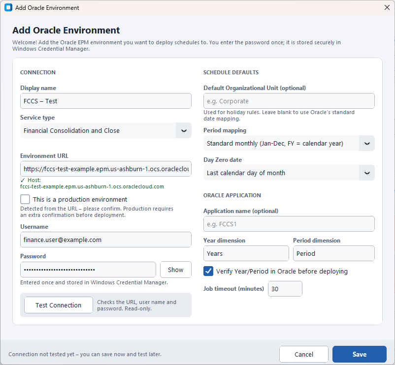

1. **Display name** – any name that helps you recognise the system, for example `FCCS – Test`.
2. **Service type** – keep **Financial Consolidation and Close**.
3. **Environment URL** – copy the address of your Oracle login page from your browser and paste it here. The
   application keeps only the host part and shows it below the field, for example
   `fccs-test-example.epm.us-ashburn-1.ocs.oraclecloud.com`.
4. **This is a production environment** – the application ticks this automatically when the address does not
   contain "test". Check that it is correct: production environments get a red **PRODUCTION** badge and an extra
   confirmation before every deployment.
5. **Username** and **Password** – your Oracle user (see [Before you start](#before-you-start)). The password is shown as
   dots; click **Show** to check what you typed.
6. The right-hand side holds the defaults for your schedules. For FCCS the defaults are correct: **Standard
   monthly** period mapping, Day Zero **Last calendar day of month**, Year dimension `Years`, Period dimension
   `Period`. Leave **Default Organizational Unit** empty unless you were told to use one.

Click **Test Connection**. The application signs in to Oracle and lists the applications it can see. Nothing is
changed in Oracle.

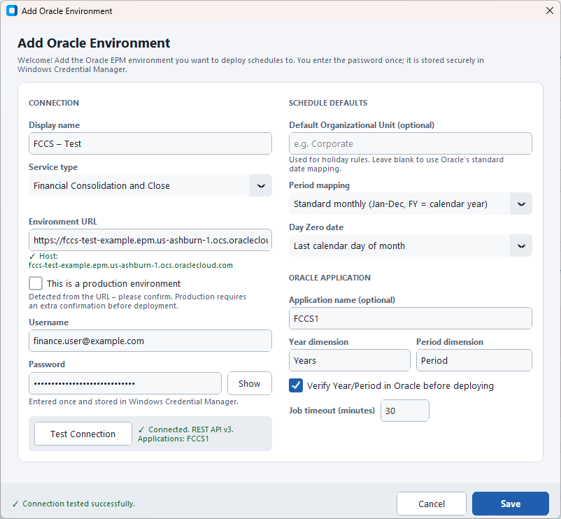

When you see the green **Connected** message, click **Save**.

### Your password is stored once, securely

The password is saved in **Windows Credential Manager** – the same secure store Windows uses for its own
passwords. It is protected by your Windows login and is never written to a file, a log or a report. You do not
have to enter it again next time. If your Oracle password changes, see
[Wrong or changed password](#wrong-or-changed-password).

## The main window

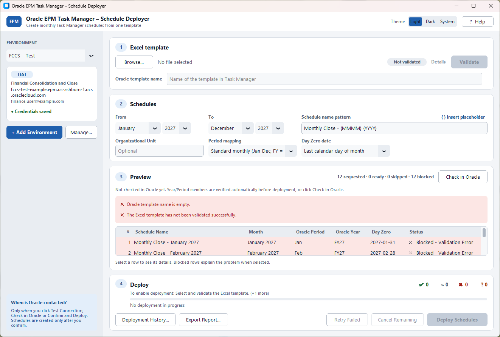

- **Left side – Environment:** the Oracle system you are working with, its badge (**TEST** or **PRODUCTION**),
  the host, the user name and whether a password is saved.
- **1 Excel template:** the template export file and the Oracle template name.
- **2 Schedules:** which months, how the schedules are named and how dates are calculated.
- **3 Preview:** one row per month with the schedule name, Oracle Period, Oracle Year, Day Zero and status.
- **4 Deploy:** the buttons that start and follow a deployment, with progress and counters
  (✔ created, » skipped, ✖ failed, ? unknown).

The box at the bottom left reminds you when Oracle is contacted. The **Theme** switch at the top changes between
light and dark colours.

## Monthly workflow, step by step

### Step 1 – Select the template

1. Click **Browse…** in section **1** (or press Ctrl+O) and select the template export, for example
   `NA Monthly Close.csv`.
2. The file is checked straight away. When it has no errors, the badge shows **Valid** (or **Valid · 1 warning(s)**).
3. Check the **Oracle template name**. It must match the template name in Oracle Task Manager **exactly**, for
   example `NA Monthly Close`. It is filled in from the file name; correct it if needed.

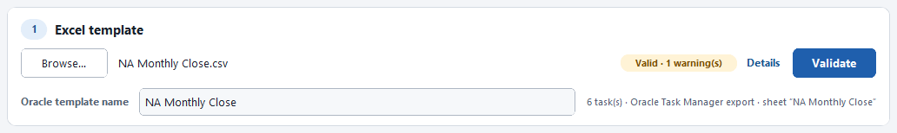

Click **Details** to see what was checked. **Errors** must be fixed in the template before you can deploy.
**Warnings** and **Info** are for your information only – for example tasks without an assignee.

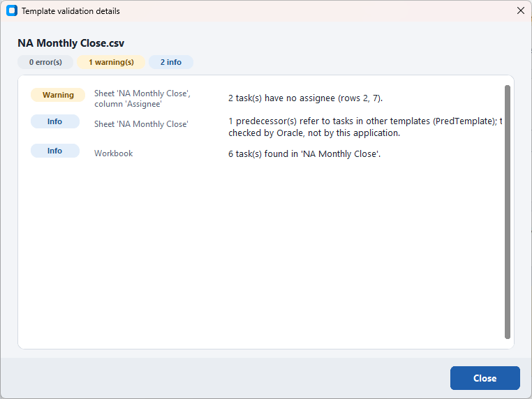

### Step 2 – Choose the months and the name

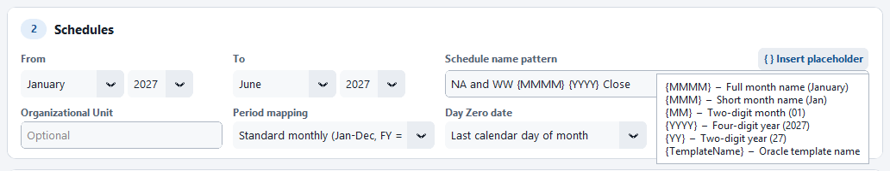

1. **From** and **To** – the first and the last month to create, for example January 2027 to June 2027. One
   schedule is created for each month in between.
2. **Schedule name pattern** – the name of each schedule, with placeholders that are replaced for every month.
   For the NA and WW close use:

   `NA and WW {MMMM} {YYYY} Close`

   This gives "NA and WW January 2027 Close", "NA and WW February 2027 Close" and so on. Click
   **{ } Insert placeholder** to insert a placeholder at the cursor.

| Placeholder | Becomes (example for June 2026) |
|---|---|
| `{MMMM}` | Full month name: June |
| `{MMM}` | Short month name: Jun |
| `{MM}` | Two-digit month: 06 |
| `{YYYY}` | Four-digit year: 2026 |
| `{YY}` | Two-digit year: 26 |
| `{TemplateName}` | The Oracle template name: NA Monthly Close |

3. **Organizational Unit** – optional. Oracle uses it for holidays and working days. Leave it empty to use
   Oracle's standard date mapping.
4. **Period mapping** – how a calendar month becomes an Oracle Year and Period. For FCCS use **Standard monthly
   (Jan-Dec, FY = calendar year)**: June 2026 becomes Period `Jun` and Year `FY26`.
5. **Day Zero date** – the reference date from which Oracle calculates every task date of the schedule (the day
   offsets in the template are counted from Day Zero). For the monthly close use **Last calendar day of month**:
   June 2026 gets Day Zero 2026-06-30. Other choices are the last business day (Monday to Friday), the first day
   of the next month, or a fixed day of the month.

The settings in points 3 to 5 come from the environment defaults; you only change them for a special run.

### Step 3 – Review the preview

The preview updates as soon as you change something. Each row shows the schedule name, the month, the Oracle
Period and Year, the Day Zero date and the status. Click a row to read its details below the table.

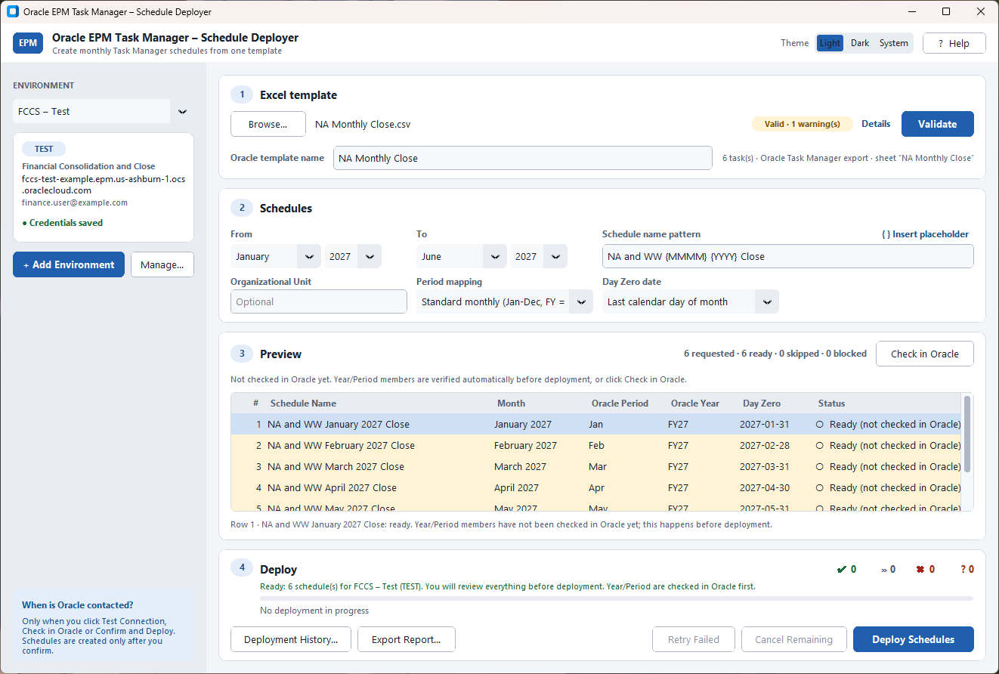

**Ready (not checked in Oracle)** means everything looks correct on your computer, but the Year and Period have not
been confirmed in Oracle yet.

### Step 4 – Check in Oracle

Click **Check in Oracle** (top right of the preview). The application asks Oracle whether the Year and Period of
every month exist, for example `FY27` and `Jan`. This only reads information; nothing is changed.

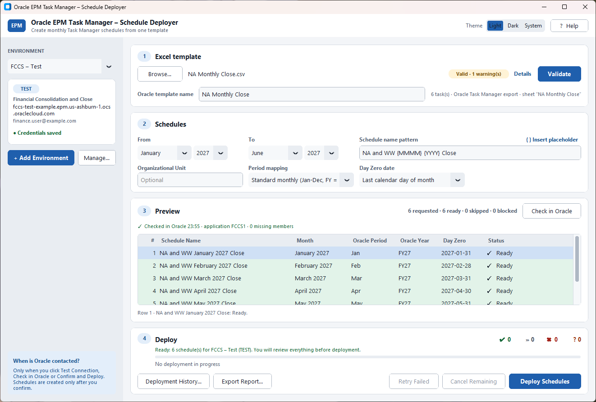

When everything exists, the rows become **Ready** and the line above the table says "0 missing members".

If a Year or Period does not exist in Oracle (or your user cannot see it), the affected months are **Blocked** and
the message tells you which member is missing. In the example below, `FY28` does not exist yet, so January and
February 2028 are blocked; November and December 2027 can still be deployed.

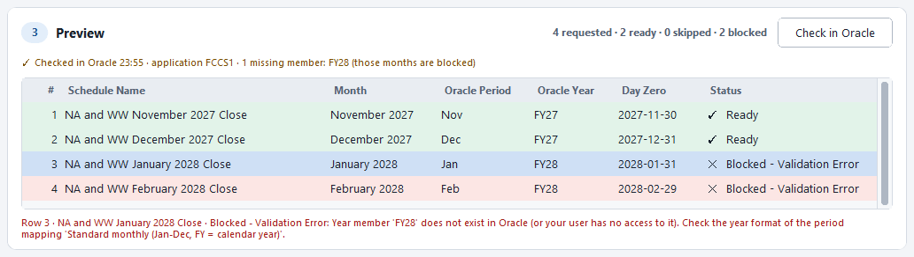

> **Note:** You do not have to click Check in Oracle yourself – **Deploy Schedules** runs the check first if it has
> not been done in the last 30 minutes.

### Step 5 – Deploy and confirm

Section **4** says "Ready: 6 schedule(s) for FCCS – Test (TEST)" when everything is in place. If the button is
grey, the line above it says what is still missing (hover over the button to see the full list).

Click **Deploy Schedules**. The confirmation window shows exactly what will happen: the environment and its full
host, the template, the name pattern with an example, the period and how many schedules will be created or
skipped. **Cancel** is selected by default, so pressing Enter never deploys by accident.

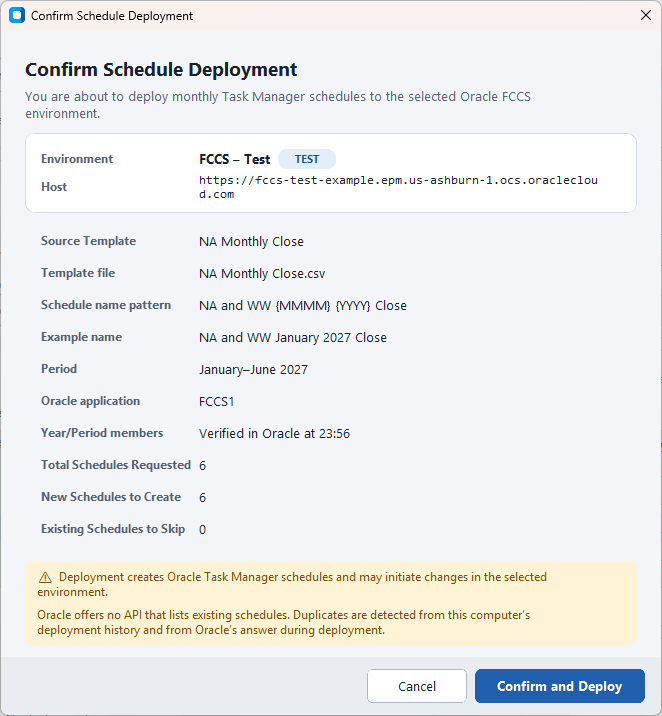

For a **production** environment the window is red, and **Confirm and Deploy** works only after you tick
**I understand this changes the PRODUCTION environment**.

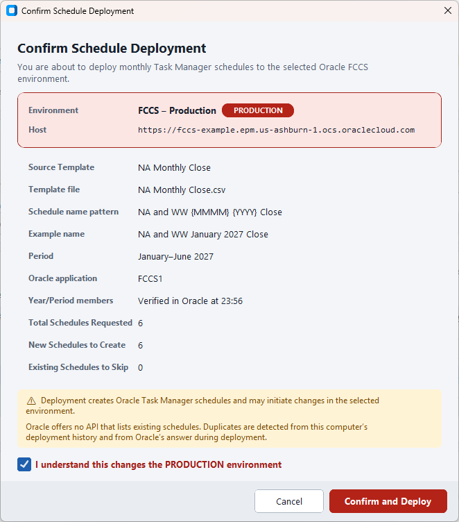

Check the environment and the example name, then click **Confirm and Deploy**.

### Step 6 – Watch the progress

The schedules are created one at a time. The table shows the status of each month, and the progress bar shows
which month is being deployed and what the application is waiting for.

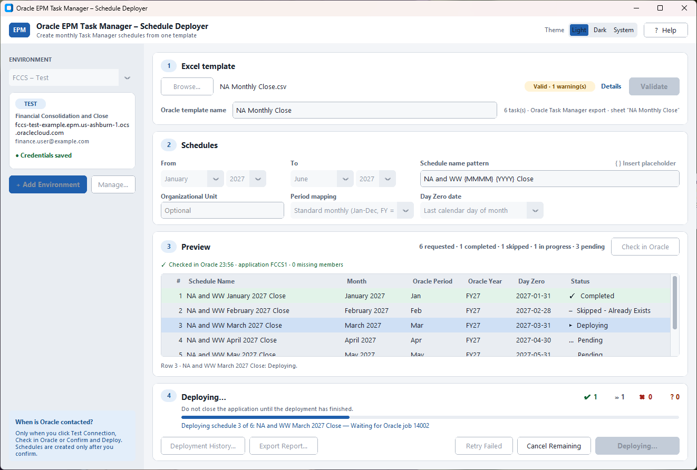

- Do not close the application while it deploys. If you must stop, click **Cancel Remaining**: the month that is
  running finishes (Oracle cannot stop a running job), the remaining months are not started.
- Settings are locked during the deployment, so nothing can change half-way.

### Step 7 – Read the summary and export the report

When the run is finished, a summary shows how many schedules were requested, created, skipped, failed, have an
unknown result or were not started, and what to do next.

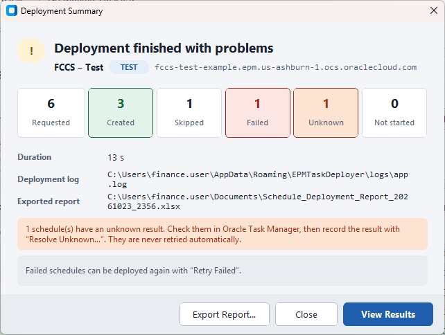

Click **Export Report…** to save an Excel report of the run (you can also use **Export Report…** in section 4 at
any time). The report contains:

- **Summary** – environment, template, name pattern, period, Year/Period check and totals;
- **Schedules** – every month with its status, Oracle job number and message;
- **Validation Issues** and **Unknown Columns** – the results of the template check;
- **Deployment History** – everything this computer has deployed to the environment.

Keep the report with your close documentation, or send it to support if something went wrong.

Click **View Results** to go back to the main window. The preview now shows the result of every month; the first
row that needs attention is selected.

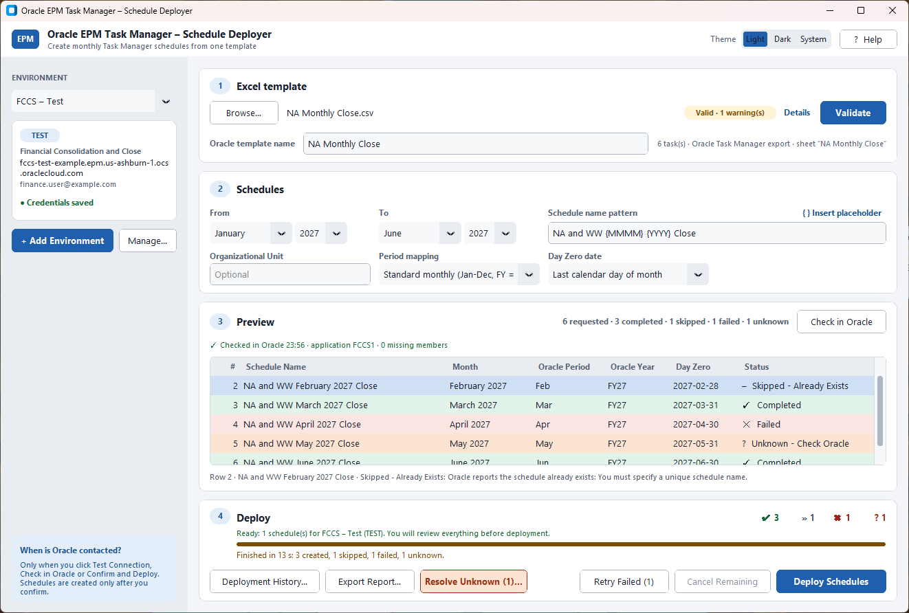

Finally, open Oracle Task Manager → Schedules and check the new schedules. They are in the status Pending; opening
them stays your decision.

## Statuses and what to do

| Status | What it means | What to do |
|---|---|---|
| **Ready** | Everything was checked, including Year and Period in Oracle. | Nothing – it will be deployed. |
| **Ready (not checked in Oracle)** | Correct on your computer; Year and Period not yet confirmed in Oracle. | Nothing – the check runs automatically before deployment. Or click **Check in Oracle**. |
| **Blocked - Validation Error** | This month cannot be deployed. Click the row to see why: missing Year or Period member, empty or duplicate name, template errors, or an earlier unknown result. | Fix the cause shown in the message. The other months are not affected. |
| **Skipped - Already Exists** | The schedule already exists: this computer created it before, or Oracle answered "You must specify a unique schedule name." | Nothing. Nothing is created twice. |
| **Pending** | Waiting to be deployed in the current run, or not started because the run was stopped. | Wait, or use **Retry Failed** after the run. |
| **Deploying** | Oracle is creating this schedule now. | Wait. |
| **Completed** | Oracle confirmed that the schedule was created. | Check it in Oracle Task Manager if you wish. |
| **Failed** | Oracle refused the request or the job ended with an error. The message shows Oracle's reason. | Fix the reason, then use **Retry Failed**. |
| **Unknown - Check Oracle** | The request was sent, but Oracle did not confirm the result (for example the network dropped). The schedule may or may not exist. | Check in Oracle and use **Resolve Unknown…**. Never retried automatically. |

You may also see **Skipped** during a run: the deployment history showed that the schedule had been created
already, so it was not sent again.

## Handling problems

### Retry Failed

After a run with failed or not-started months, **Retry Failed (n)** in section 4 becomes active. It deploys again
only those months – schedules already created or existing are skipped automatically. A short confirmation shows
the list first.

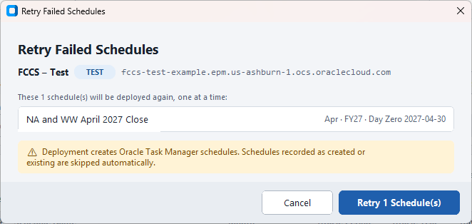

Before retrying, fix the reason shown in the row message (for example a locked period in Oracle).

### Resolve Unknown results

An *unknown* result means the application cannot tell whether Oracle created the schedule. To avoid duplicates
such months are never retried automatically and stay blocked until you decide. Click **Resolve Unknown (n)…**.

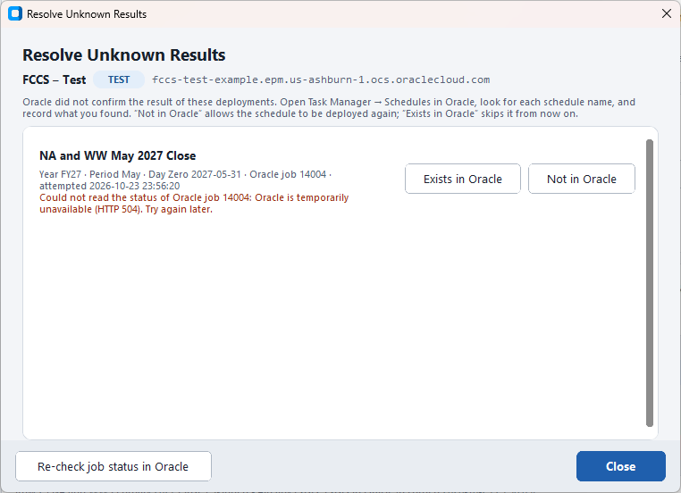

1. First click **Re-check job status in Oracle**. The application asks Oracle once more for the result of the job
   (read-only). Often this resolves the month automatically.
2. If it stays unknown, open Oracle Task Manager → Schedules and look for the schedule name.
3. Record what you found:
   - **Exists in Oracle** – the schedule is there; it will be skipped from now on.
   - **Not in Oracle** – the schedule is not there; it can be deployed again (with **Retry Failed** or a new deployment).

### Deployment History

**Deployment History…** in section 4 lists everything this computer has deployed to the selected environment, with
the status, Oracle job number and message. Click a row to see the full details. Oracle offers no way to list
schedules, so this history is what prevents duplicates.

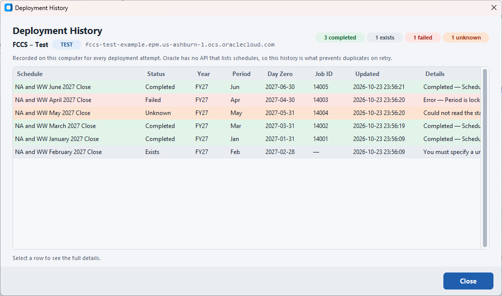

### Wrong or changed password

If Oracle rejects the user name or password, the application stops and offers **Update Password…**. You can also
open it at any time with **Manage…** → **Update Password…**. Enter the new password and click **Save Password**;
it replaces the old one in Windows Credential Manager.

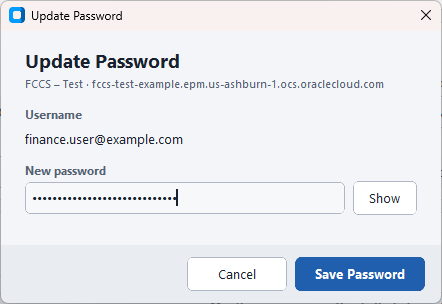

If a deployment stopped because of the password, update it and then click **Retry Failed** – only the remaining
months are deployed.

### A Year or Period member is missing

The row is **Blocked** and the message names the member, for example "Year member 'FY28' does not exist in Oracle".
Either the year has not been set up in Oracle yet (ask your Oracle administrator), or the period mapping does not
match your application. Choose months that exist, or ask your administrator.

### The template is not found

If the Oracle template name does not exist, Oracle refuses the first month and the application stops the run
before trying the other months (they stay **Pending**). Compare the **Oracle template name** in section 1 with the
template name in Task Manager → Templates – it must match exactly, including spaces. Correct it, then click
**Retry Failed**.

### Duplicates

You cannot create the same schedule twice by accident:

- the application remembers every schedule it created (deployment history), and
- Oracle itself refuses a name that already exists ("You must specify a unique schedule name."). The application
  shows such months as **Skipped - Already Exists**.

If two months of one run would get the same name (for example a pattern without `{MMMM}`), those rows are blocked
before anything is sent – add a month placeholder to the pattern.

### Not allowed (Service Administrator)

If Oracle answers that your user is not allowed to deploy Task Manager templates, the run stops. Ask your Oracle
administrator for the **Service Administrator** role, or for a service account that has it, then use **Retry Failed**.

## Managing environments

Click **Manage…** below the environment list.

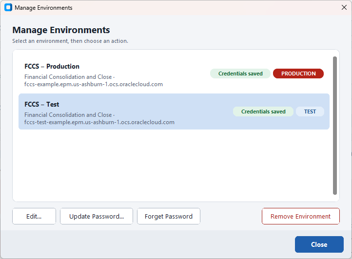

Select an environment, then:

- **Edit…** – change the name, URL, user name or the schedule defaults. Leave the password empty to keep the saved one.
- **Update Password…** – enter a new password (for example after a password change in Oracle).
- **Forget Password** – remove the saved password from Windows Credential Manager. The environment stays in the list.
- **Remove Environment** – remove the environment and its saved password from this computer. Nothing is changed in
  Oracle, and the deployment history file is kept.

Use **+ Add Environment** to add another system, for example production next to test, and switch between them
with the list at the top left. The **PRODUCTION** badge is red everywhere: in the list, in the left panel and in
the confirmation window.

> **Tip:** Try a new template or a new naming pattern on the test environment first.

## Where your data is stored

Everything stays on your computer, in your Windows user profile.

| What | Where |
|---|---|
| Environments (name, URL, user name, defaults – no password) | `%APPDATA%\EPMTaskDeployer\environments.json` |
| Passwords | Windows Credential Manager, entry `EPMTaskDeployer:<environment>` (Control Panel → Credential Manager → Windows Credentials) |
| Application log (passwords are never written) | `%APPDATA%\EPMTaskDeployer\logs\app.log` |
| Deployment history (prevents duplicates) | `%APPDATA%\EPMTaskDeployer\ledger\<environment>.json` |
| Theme setting | `%APPDATA%\EPMTaskDeployer\ui_settings.json` |

To open the folder, type `%APPDATA%\EPMTaskDeployer` into the address bar of File Explorer.

> **Warning:** Do not delete or edit the files in the `ledger` folder. They are what prevents a schedule from being
> created twice.

### What to send to support

- the exported Excel report of the run,
- the log file `%APPDATA%\EPMTaskDeployer\logs\app.log`,
- a screenshot of the message you saw.

Never send your password. Support will never ask for it.

## Frequently asked questions

**Does the application change anything in Oracle when I only look at the preview?**
No. Oracle is contacted only when you click Test Connection, Check in Oracle, Confirm and Deploy, or Re-check job
status in Oracle. Only Confirm and Deploy creates schedules.

**Can I create schedules for a whole year at once?**
Yes. Choose January to December. The months are created one after the other; you can follow each one in the table.

**What happens if I select a month that was already created?**
It is shown as **Skipped - Already Exists** and nothing is sent for it.

**Does the application open the schedules?**
No. New schedules stay Pending. Opening them is done in Oracle, as before.

**I closed the application during a deployment. What now?**
The application asks you to confirm and finishes the running month first. Start it again, select the same months
and deploy: months already created are skipped. Months with an unknown result appear under **Resolve Unknown**.

**Do I need a new template export every month?**
No. You only need a new export when the template changes in Oracle.

**Can I use my normal company (SSO) login?**
No. Oracle allows this kind of connection only with a user name and password that work without SSO or MFA.
See [Before you start](#before-you-start).

**Can several colleagues use the application?**
Yes. Each person runs it on their own computer with their own saved environments and password. The deployment
history is kept per computer, but Oracle itself still refuses duplicate names, so a schedule created by a colleague
shows as **Skipped - Already Exists**.

**Does it work for Account Reconciliation (ARCS)?**
No. ARCS has no Task Manager. The application tells you so if you select this service type.

**Can I use dark colours?**
Yes. Use the **Theme** switch at the top right (Light, Dark or System).

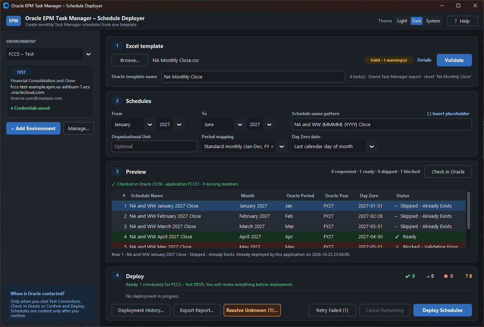
